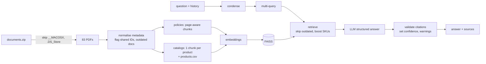

# IronStore Assistant: solution

A chat assistant that answers IronStore employees' questions from the 83 internal PDFs.
Every answer cites the **document and page** it comes from, shows a **confidence level**, and says
plainly when the documents don't contain the answer.

## Quick start

```bash
python -m venv .venv && source .venv/bin/activate
pip install -r requirements.txt
cp .env.example .env            # add your OPENAI_API_KEY

python -m ironstore_assistant.build_index    # unzip, clean, parse, embed (~1 min)
streamlit run app.py                         # chat UI at http://localhost:8501
# or: python cli.py   /   python cli.py --agent
```

No API key yet? `python -m ironstore_assistant.build_index --embeddings tfidf` builds an offline
index so you can explore retrieval, run the notebooks and run the tests. Answering still needs an OpenAI key.

## Teaching notebooks

The `notebooks/` folder walks through the project step by step and links every step to the course
notebook it comes from. They are saved with outputs, and they all run without an API key: wherever an
LLM call is needed, a scripted `FakeLLM` stands in until you add `OPENAI_API_KEY` to `.env`.

| Notebook | What it teaches | Course modules |
|---|---|---|
| [01 Data inspection and cleaning](notebooks/01_data_inspection_and_cleaning.ipynb) | Finding the junk files, inconsistent headers, shared ID, outdated catalog, catalog layouts and reused SKUs | Python, pandas, data viz |
| [02 Embeddings and vector search](notebooks/02_embeddings_and_vector_search.ipynb) | Chunking, cosine similarity, FAISS, metadata filters, PCA of the embedding space | Embeddings, LangChain RAG, unsupervised ML |
| [03 RAG chain with citations](notebooks/03_rag_chain_with_citations.ipynb) | Prompt, LCEL chain, structured output, citation validation, saying "I don't know" | LLM APIs, prompt engineering, structured outputs, LCEL, RAG |
| [04 Memory and multi-query](notebooks/04_memory_and_multi_query.ipynb) | Condensing follow-ups, window memory, multi-query and rank fusion | Conversation history, LangChain memory, multi-query |
| [05 Agents and tools](notebooks/05_agents_and_tools.ipynb) | `@tool`, tool schemas, the tool-calling loop, RAG vs agent | Tool calling, LangChain agents, building tools |
| [06 Evaluation and safety](notebooks/06_evaluation_and_safety.ipynb) | Direct and indirect prompt injection, the evaluation set, retrieval metrics | Prompt injections, model evaluation |

## Deploy (Streamlit Community Cloud, free)

1. Go to [share.streamlit.io](https://share.streamlit.io), sign in with GitHub and click **Create app → Deploy a public app from GitHub** (private repos work too; the app is then visible only to people you invite).
2. Repository `roberto-vargas-c/project-brief-enterprise-ai-assistant`, branch `main` (or this PR's branch before merging), main file `app.py`.
3. Under **Advanced settings → Secrets**, paste (see `.streamlit/secrets.toml.example`):
   ```toml
   OPENAI_API_KEY = "sk-..."
   APP_PASSWORD = "choose-a-password"   # optional, keeps strangers from using your credits
   ```
4. Click **Deploy**. The first visit builds the index (about 1-2 minutes, a few cents of embeddings); later visits are instant until the app restarts.

## Why these tools

All choices come from what the course covers (`demos_ai_engineering_sept2026`):

| Need | Tool | Why | Course reference |
|---|---|---|---|
| Orchestration | **LangChain (LCEL)** | Prompt templates, retrievers, structured output and tool calling in one place; every step is a small runnable that is easy to test. | `N_LangChain/02`, `03` |
| LLM | **OpenAI chat model** via `langchain_openai.ChatOpenAI` | The model family used throughout the course. Configurable with `IRONSTORE_CHAT_MODEL`. | `L_LLM_APIs/2`, `N_LangChain/*` |
| Embeddings | **OpenAI embeddings** (`text-embedding-3-small`), with **sentence-transformers** or **TF-IDF** as free options | Best quality by default; the alternatives run without a key. | `N_LangChain/03`, `I_Embeddings/2` |
| Vector store | **FAISS** | Local, free, no account; ~4k chunks is small. Pinecone (notebook 03) would only matter at a much larger scale. | `N_LangChain/08` |
| Trustworthy answers | **Pydantic structured output** | The model must return `answer`, `citations`, `confidence`, `answerable`, so citations can be checked in code instead of trusted. | `L_LLM_APIs/6` |
| Follow-up questions | **Conversation memory** (window of the last 6 turns + question condensing) | "And for contractors?" works. | `N_LangChain/04`, `L_LLM_APIs/4` |
| Better recall | **Multi-query retrieval** with rank fusion | Employees say "time off", the policy says "annual leave". | `N_LangChain/11` |
| Exact lookups | **Tool-calling agent** | Embeddings are bad at exact SKUs and prices; a `lookup_product` tool reads the parsed product table. | `L_LLM_APIs/5`, `N_LangChain/05`, `10` |
| Safety | **Prompt-injection rules** | Documents and questions are treated as data, never as instructions. | `L_LLM_APIs/8` |
| PDF text | **pypdf** | Keeps page numbers for citations. | — |
| Chat UI | **Streamlit** | Not in the course, but the fastest way to a real chat page with expandable sources. | — |

## How it works



In **agent mode** the retrieval step is replaced by a tool-calling loop (`search_policies`,
`search_products`, `lookup_product`, `list_documents`). Everything the tools return goes through the
same answer and validation step, so the citations work the same way.

## How the messy data is handled

Full details in [`docs/data_quality_report.md`](docs/data_quality_report.md), generated by the
ingestion step.

| Problem found | What the assistant does |
|---|---|
| macOS junk in the zip (`__MACOSX/`, `.DS_Store`) | Skipped on extraction (with zip-slip protection). |
| 2021 catalog (30 pages) conflicts with the August 2026 catalogs | Marked `OUTDATED` (reviewed >12 months before the newest document). Excluded from retrieval unless the user asks about old data ("2021", "old", "previous"…) or ticks *Include outdated documents*. If used, the answer gets a warning. |
| `CS-POL-014 v3.2` is used by **two different policies** (Escalation Procedures and Refund & Complaint Handling) | Documents are keyed by file, not ID. Both are flagged `id_conflict`; the context tells the LLM the ID is shared and the prompt makes it cite titles. |
| Header fields differ: *Policy ID* / *Document ID* / *Policy reference*, "Last reviewed:" / "Last reviewed in", version or effective date missing in 10 policies | Normalised into one metadata schema (`doc_id`, `version`, `last_reviewed`, `effective_date`). Department comes from the folder, because one file puts the department in "Document owner". |
| At least six different catalog layouts, PDF bullets extracted as control characters | Catalog parser anchored on the `Category:` line; 3,252 products parsed from all 63 catalogs. Each product is one chunk, so a chunk never mixes two products. |
| **SKUs reused by different products** (`IS-BED-001`…`004` in *Bedding & Linens* and *Home Essentials*) | Reported, and `lookup_product` returns both with a warning instead of picking one. |
| A product printed twice in a row (Seasonal & Holiday Decor), products with missing price or availability | Merged / reported in the data-quality report. |
| Catalog notes, legends and summary tables between products | Indexed separately as "catalog notes", so they don't pollute product chunks. |

## Bonus features

- **Conversation memory** with question condensing.
- **Multi-query retrieval** (toggle in the sidebar).
- **Agent mode** with four tools, including exact SKU/name lookup on the parsed product table.
- **Citation validation**: citations to passages that weren't retrieved are dropped; an answer without valid citations is downgraded to low confidence.
- **Prompt-injection guard** in the system prompt and tests.
- **Data-quality report** (`python -m ironstore_assistant.ingest`).
- **Evaluation set** of 20 cases including every trap (`python -m ironstore_assistant.evaluate`).
- **Department filter** and **include outdated** switch in the UI.
- **Offline mode** (TF-IDF embeddings) and **21 offline tests** with a fake LLM.

## Evaluation

```bash
python -m ironstore_assistant.evaluate --retrieval-only   # retriever only, no LLM calls
python -m ironstore_assistant.evaluate                    # full answers, RAG mode
python -m ironstore_assistant.evaluate --agent            # full answers, agent mode
```

The full run checks, per case: correct `answerable` flag, expected documents cited, key facts in the
answer, no leaked system prompt, and an outdated warning when the 2021 catalog is used.

With the **offline TF-IDF** embeddings the retriever already gets **93% recall@6** and an **80% top-1 hit**
on the 15 cases with an expected source ([`docs/retrieval_eval_tfidf.md`](docs/retrieval_eval_tfidf.md)).
OpenAI embeddings should do better on paraphrased questions; run the evaluation after building the index
with your key to get the real numbers.

## Tests

```bash
pytest -q        # offline: TF-IDF index + scripted fake LLM, ~30 s
```

## Project structure

```
ironstore_assistant/
  config.py        settings (env vars / .env)
  ingest.py        zip -> clean PDFs -> metadata -> chunks, data-quality report
  catalog.py       product catalog parser (one record per product)
  index.py         embeddings + FAISS build/load
  build_index.py   one-command pipeline
  prompts.py       all prompts
  rag.py           Retriever + Assistant (memory, multi-query, structured answer, validation)
  agent.py         tool-calling agent (bonus)
  evaluate.py      evaluation set and scorer (bonus)
  fake_llm.py      scripted stand-in LLM for tests and key-less notebooks
app.py             Streamlit chat UI
cli.py             terminal chat
tests/             offline tests
notebooks/         teaching notebooks (course concepts applied here)
.streamlit/        theme + secrets example for deployment
docs/              generated data-quality report and retrieval evaluation
```

## Limitations and next steps

- Answers need an OpenAI key; the default model name follows the course notebooks and can be changed in `.env`.
- Catalog page numbers are **PDF pages** (what you see in a PDF viewer), not the catalogs' own "Page N — Section" labels.
- The catalog parser is heuristic; two Yoga & Pilates products have no availability in the source PDF itself.
- `langchain-community` is being sunset upstream; the FAISS wrapper can later move to a standalone package.
- Next: streaming answers in the UI, user feedback buttons feeding the evaluation set, access control per department.
