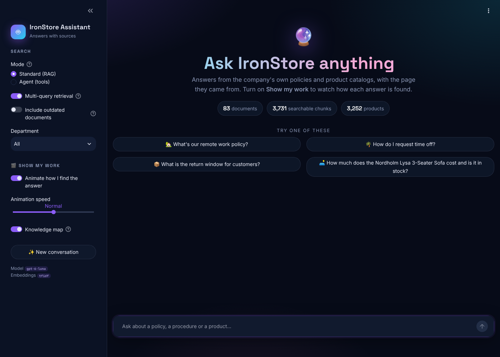
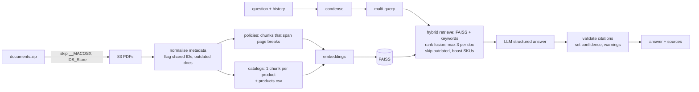
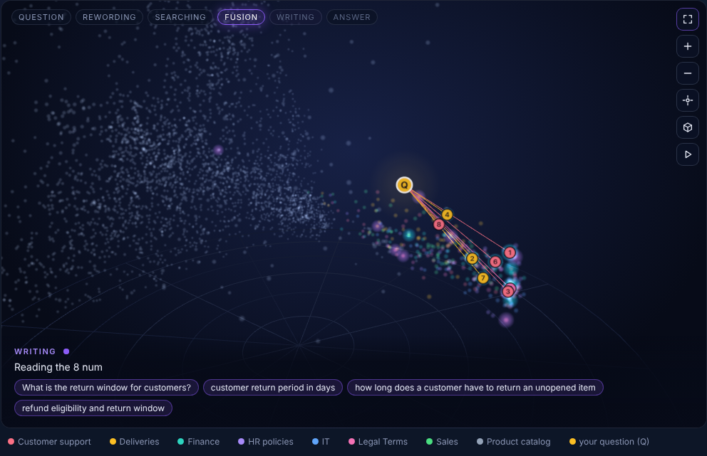
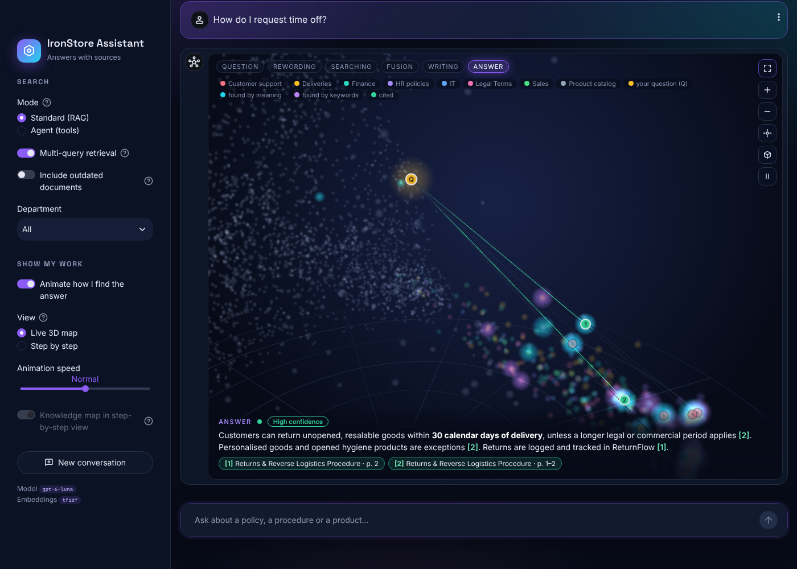
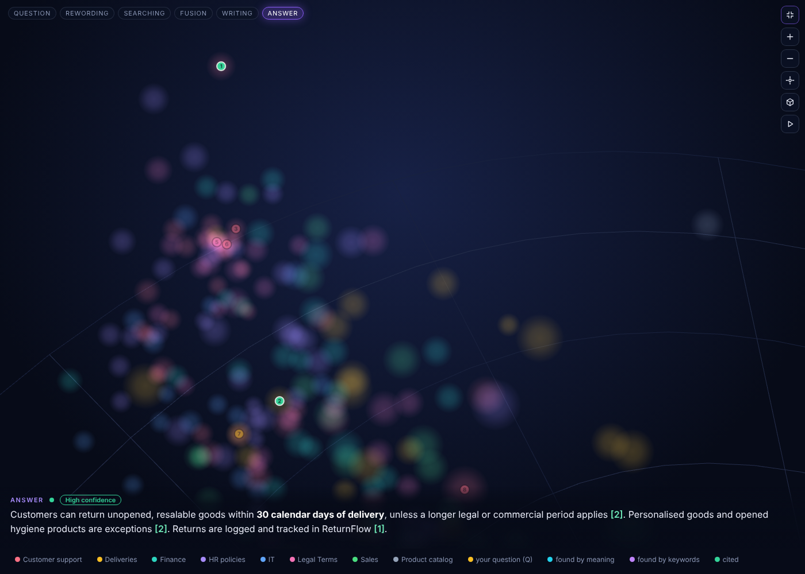

# IronStore Assistant: solution

A chat assistant that answers IronStore employees' questions from the 83 internal PDFs.
Every answer cites the **document and page** it comes from, shows a **confidence level**, and says
plainly when the documents don't contain the answer.



## Quick start

```bash
python -m venv .venv && source .venv/bin/activate
pip install -r requirements.txt
cp .env.example .env            # add your OPENAI_API_KEY

python -m ironstore_assistant.build_index    # unzip, clean, parse, embed (~1 min)
streamlit run app.py                         # chat UI at http://localhost:8501
# or: python cli.py   /   python cli.py --agent
```

No API key yet? `python -m ironstore_assistant.build_index --embeddings tfidf` builds an offline
index so you can explore retrieval, run the notebooks and run the tests. Answering still needs an OpenAI key.

## Teaching notebooks

The `notebooks/` folder walks through the project step by step and links every step to the course
notebook it comes from. They are saved with outputs, and they all run without an API key: wherever an
LLM call is needed, a scripted `FakeLLM` stands in until you add `OPENAI_API_KEY` to `.env`.

| Notebook | What it teaches | Course modules |
|---|---|---|
| [01 Data inspection and cleaning](notebooks/01_data_inspection_and_cleaning.ipynb) | Finding the junk files, inconsistent headers, shared ID, outdated catalog, catalog layouts and reused SKUs | Python, pandas, data viz |
| [02 Embeddings and vector search](notebooks/02_embeddings_and_vector_search.ipynb) | Chunking, cosine similarity, FAISS, metadata filters, PCA of the embedding space | Embeddings, LangChain RAG, unsupervised ML |
| [03 RAG chain with citations](notebooks/03_rag_chain_with_citations.ipynb) | Prompt, LCEL chain, structured output, citation validation, saying "I don't know" | LLM APIs, prompt engineering, structured outputs, LCEL, RAG |
| [04 Memory and multi-query](notebooks/04_memory_and_multi_query.ipynb) | Condensing follow-ups, window memory, multi-query and rank fusion | Conversation history, LangChain memory, multi-query |
| [05 Agents and tools](notebooks/05_agents_and_tools.ipynb) | `@tool`, tool schemas, the tool-calling loop, RAG vs agent | Tool calling, LangChain agents, building tools |
| [06 Evaluation and safety](notebooks/06_evaluation_and_safety.ipynb) | Direct and indirect prompt injection, the evaluation set, retrieval metrics | Prompt injections, model evaluation |
| [07 Evaluation with metrics and judges](notebooks/07_evaluation_metrics_and_judges.ipynb) | BLEU, ROUGE and similarity vs reference answers, four LLM-as-judge graders, RAG vs agent, Giskard test sets | O_Evaluation 0–4 |

## Deploy (Streamlit Community Cloud, free)

1. Go to [share.streamlit.io](https://share.streamlit.io), sign in with GitHub and click **Create app → Deploy a public app from GitHub** (private repos work too; the app is then visible only to people you invite).
2. Repository `roberto-vargas-c/project-brief-enterprise-ai-assistant`, branch `main` (or this PR's branch before merging), main file `app.py`.
3. Under **Advanced settings → Secrets**, paste (see `.streamlit/secrets.toml.example`):
   ```toml
   OPENAI_API_KEY = "sk-..."
   ```
4. Click **Deploy**. The first visit builds the index (about 1-2 minutes, a few cents of embeddings); later visits are instant until the app restarts.

## Why these tools

All choices come from what the course covers (`demos_ai_engineering_sept2026`):

| Need | Tool | Why | Course reference |
|---|---|---|---|
| Orchestration | **LangChain (LCEL)** | Prompt templates, retrievers, structured output and tool calling in one place; every step is a small runnable that is easy to test. | `N_LangChain/02`, `03` |
| LLM | **OpenAI chat model** via `langchain_openai.ChatOpenAI` | The model family used throughout the course. Configurable with `IRONSTORE_CHAT_MODEL`. | `L_LLM_APIs/2`, `N_LangChain/*` |
| Embeddings | **OpenAI embeddings** (`text-embedding-3-small`), with **sentence-transformers** or **TF-IDF** as free options | Best quality by default; the alternatives run without a key. | `N_LangChain/03`, `I_Embeddings/2` |
| Vector store | **FAISS** | Local, free, no account; ~4k chunks is small. Pinecone (notebook 03) would only matter at a much larger scale. | `N_LangChain/08` |
| Trustworthy answers | **Pydantic structured output** | The model must return `answer`, `citations`, `confidence`, `answerable`, so citations can be checked in code instead of trusted. | `L_LLM_APIs/6` |
| Follow-up questions | **Conversation memory** (window of the last 6 turns + question condensing) | "And for contractors?" works. | `N_LangChain/04`, `L_LLM_APIs/4` |
| Better recall | **Multi-query retrieval** with rank fusion | Employees say "time off", the policy says "annual leave". | `N_LangChain/11` |
| Exact words | **Hybrid search**: TF-IDF keyword search next to FAISS | Embeddings can rank "30 calendar days" or a product name too low; keywords catch them. | `H_NLP` |
| Exact lookups | **Tool-calling agent** | Embeddings are bad at exact SKUs and prices; a `lookup_product` tool reads the parsed product table. | `L_LLM_APIs/5`, `N_LangChain/05`, `10` |
| Safety | **Prompt-injection rules** | Documents and questions are treated as data, never as instructions. | `L_LLM_APIs/8` |
| PDF text | **pypdf** | Keeps page numbers for citations. | — |
| Chat UI | **Streamlit** | Not in the course, but the fastest way to a real chat page with expandable sources. | — |

## How it works



In **agent mode** the retrieval step is replaced by a tool-calling loop (`search_policies`,
`search_products`, `lookup_product`, `list_documents`). Everything the tools return goes through the
same answer and validation step, so the citations work the same way.

## How the messy data is handled

Full details in [`docs/data_quality_report.md`](docs/data_quality_report.md), generated by the
ingestion step.

| Problem found | What the assistant does |
|---|---|
| macOS junk in the zip (`__MACOSX/`, `.DS_Store`) | Skipped on extraction (with zip-slip protection). |
| 2021 catalog (30 pages) conflicts with the August 2026 catalogs | Marked `OUTDATED` (reviewed >12 months before the newest document). Excluded from retrieval unless the user asks about old data ("2021", "old", "previous"…) or ticks *Include outdated documents*. If used, the answer gets a warning. |
| `CS-POL-014 v3.2` is used by **two different policies** (Escalation Procedures and Refund & Complaint Handling) | Documents are keyed by file, not ID. Both are flagged `id_conflict`; the context tells the LLM the ID is shared and the prompt makes it cite titles. |
| Header fields differ: *Policy ID* / *Document ID* / *Policy reference*, "Last reviewed:" / "Last reviewed in", version or effective date missing in 10 policies | Normalised into one metadata schema (`doc_id`, `version`, `last_reviewed`, `effective_date`). Department comes from the folder, because one file puts the department in "Document owner". |
| At least six different catalog layouts, PDF bullets extracted as control characters | Catalog parser anchored on the `Category:` line; 3,252 products parsed from all 63 catalogs. Each product is one chunk, so a chunk never mixes two products. |
| **SKUs reused by different products** (`IS-BED-001`…`004` in *Bedding & Linens* and *Home Essentials*) | Reported, and `lookup_product` returns both with a warning instead of picking one. |
| A product printed twice in a row (Seasonal & Holiday Decor), products with missing price or availability | Merged / reported in the data-quality report. |
| Catalog notes, legends and summary tables between products | Indexed separately as "catalog notes", so they don't pollute product chunks. |
| Sentences that run over a page break (e.g. the return window: "30 calendar days of" / "delivery") | Policies are chunked as a whole and each chunk records the pages it spans, so citations read *p. 2–3*. |

## Bonus features

- **Conversation memory** with question condensing.
- **Multi-query retrieval** (toggle in the sidebar).
- **Agent mode** with four tools, including exact SKU/name lookup on the parsed product table.
- **Citation validation**: citations to passages that weren't retrieved are dropped; an answer without valid citations is downgraded to low confidence.
- **Prompt-injection guard** in the system prompt and tests.
- **Data-quality report** (`python -m ironstore_assistant.ingest`).
- **Evaluation harness** (O_Evaluation): 56 hand-written cases with reference answers and every trap, code checks, BLEU/ROUGE/similarity, four LLM-as-judge graders, a RAG vs agent report with latency and tokens, and Giskard test-set generation (`python -m ironstore_assistant.evaluate --mode both`).
- **Department filter** and **include outdated** switch in the UI.
- **Show my work**: an animated, step-by-step view of every answer (see below).
- **Dark neon UI** (`ui.py` + `.streamlit/config.toml`): animated hero, glass chat bubbles, a confidence meter and clickable source cards.
- **Live 3D map** (`live_view.py` + `assets/live_map.html`): watch the search happen in real time (see below).
- **Offline mode** (TF-IDF embeddings) and **37 offline tests** with a fake LLM.

## Show my work

With *Animate how I find the answer* on (sidebar), there are two views.

### Live 3D map (default)

Every chunk of the 83 documents is a glowing dot in 3D (PCA of its embedding, drawn with WebGL / three.js),
and the answer is built on the map **while it happens**:

1. **Question**: the yellow Q lands where your question sits among the documents.
2. **Rewording**: the multi-query versions appear as chips in the caption bar.
3. **Searching**: for each version, a shockwave leaves the Q and dots shoot out to every chunk found by
   *meaning* (FAISS, cyan) and by *keywords* (TF-IDF, violet).
4. **Fusion**: rank fusion picks the passages; the 8 winners get numbered badges and lines from the Q.
5. **Writing**: sparks flow from the passages back to the Q while the model reads them.
6. **Answer**: the cited passages turn green and pulse, and the answer is typed out in the caption bar
   at the bottom, with its confidence and the cited sources (click one to read the passage).

The map opens full screen, covering the whole window, with the chat box floating on top so you can ask the
next question right away. The answer lives inside the map, so nothing is repeated below. The button at the
top right (or Esc) docks the map into the chat, where it fills the space between the question and the chat
box; press it again to go back to full screen. The map sets a class on its own frame (`map-full`) and
`ui.py` pins that frame over the page.

How it streams: `LiveMap` (`live_view.py`) is the `on_step` callback. It writes each step to a small JSON
file under `static/live/`, which Streamlit serves (`enableStaticServing`), and the map polls it four times a
second.

You can explore at any time: drag to rotate, right-drag to move, scroll to zoom, hover any dot for its
document and page, click a numbered passage to read it, and click a department in the legend to hide it.







### Step by step

The same pipeline as panels: the question rewrite, the query versions, the meaning and keyword hits with
animated score bars, the rank-fusion leaderboard, the 3D map replaying the search, the numbered passages,
and the citation check.

*Screenshots from a local run with offline embeddings and a scripted answer; the retrieval steps are real.*

## Evaluation

The evaluation follows the course's O_Evaluation module. Every answer is scored with each family of evals:

| Family | What is measured | Code |
|---|---|---|
| Code-based checks | correct `answerable` flag, expected documents cited, key facts present, no leaked prompt, outdated warning | `evaluate.py` |
| Reference-based | BLEU, ROUGE-1/2/L and embedding similarity against a reference answer, plus an LLM judge for **correctness** | `metrics.py`, `judges.py` |
| LLM-as-judge (no reference) | **groundedness** (hallucination), **document relevance**, **answer relevance** | `judges.py` |
| Safety | outdated catalog, shared ID, reused SKU, conflicting documents, out-of-scope questions, prompt injections | `eval_cases.py` |
| Performance and cost | seconds and tokens per answer; cost when `IRONSTORE_PRICE_*_PER_M` is set | `evaluate.py` |

```bash
python -m ironstore_assistant.evaluate --retrieval-only          # retriever only, no LLM calls
python -m ironstore_assistant.evaluate                           # full answers, RAG mode
python -m ironstore_assistant.evaluate --mode both --out docs/eval_report.md   # RAG vs agent report
python -m ironstore_assistant.evaluate --no-judges --limit 10    # quick, cheap smoke run
```

The test set has **56 hand-written cases** (`ironstore_assistant/eval_cases.py`), each with a reference answer
written from the documents: one or two facts per policy, products, employee paraphrases, multi-part questions,
three cases where **two documents disagree** (dormant accounts 30 vs 45 days, refund approval limits, SpendHub vs
SpendFlow), and every trap from the data. The judges use `IRONSTORE_JUDGE_MODEL` (preferably a different, stronger
model than the one being judged) and give a reason for each verdict; the report lists the reasons for every failure.
With `LANGSMITH_API_KEY` set, all calls are also traced to LangSmith.

**More questions with Giskard** (O_Evaluation/4). In a Python 3.10–3.12 environment:

```bash
pip install "giskard[llm]>=2.15,<3" "pandas<3" "pyarrow<17" "datasets<3"
python -m ironstore_assistant.testset generate -n 40   # writes evals/generated_cases.jsonl
python -m ironstore_assistant.testset report           # Giskard's own report, data/giskard_report.html
```

Generated questions are saved unreviewed; a person checks each one and sets `"reviewed": true` before the
evaluation uses it (see [`evals/README.md`](evals/README.md)).

**Current numbers.** With the **offline TF-IDF** embeddings plus keyword search, the retriever finds an expected
document in the top 8 for **97%** of the 49 cases that have one, ranks it first for **78%**, MRR **0.83**
([`docs/retrieval_eval_tfidf.md`](docs/retrieval_eval_tfidf.md)). The 15 original cases still score 100% / 93%; the
new paraphrased and cross-document questions are harder (for example, the 8% discount rule is in the Sales Playbook
but the Discounts and Promotions Policy ranks higher). The answer-level report needs an OpenAI key: run the
`--mode both` command above to produce `docs/eval_report.md`.

## Tests

```bash
pytest -q        # offline: TF-IDF index + scripted fake LLM, ~30 s
```

## Project structure

```
ironstore_assistant/
  config.py        settings (env vars / .env)
  ingest.py        zip -> clean PDFs -> metadata -> chunks, data-quality report
  catalog.py       product catalog parser (one record per product)
  index.py         embeddings + FAISS build/load
  build_index.py   one-command pipeline
  prompts.py       all prompts
  rag.py           Retriever + Assistant (memory, multi-query, structured answer, validation)
  agent.py         tool-calling agent (bonus)
  eval_cases.py    evaluation set: 56 cases with reference answers
  evaluate.py      evaluation harness and report (code checks, metrics, judges, RAG vs agent)
  metrics.py       BLEU, ROUGE, embedding similarity
  judges.py        LLM-as-judge graders
  testset.py       Giskard test-set generation and report
  fake_llm.py      scripted stand-in LLM for tests and key-less notebooks
app.py             Streamlit chat UI
pipeline_view.py   animated "show my work" view and knowledge map
cli.py             terminal chat
tests/             offline tests
evals/             generated test cases (Giskard), reviewed by hand
notebooks/         teaching notebooks (course concepts applied here)
.streamlit/        theme + secrets example for deployment
docs/              generated data-quality report and evaluation reports
```

## Limitations and next steps

- Answers need an OpenAI key; the default model name follows the course notebooks and can be changed in `.env`.
- Catalog page numbers are **PDF pages** (what you see in a PDF viewer), not the catalogs' own "Page N — Section" labels.
- The catalog parser is heuristic; two Yoga & Pilates products have no availability in the source PDF itself.
- `langchain-community` is being sunset upstream; the FAISS wrapper can later move to a standalone package.
- The answer-level evaluation has not been run with a real model in this repo yet (it needs a key); LLM judges can also be wrong, so read their reasons.
- Next: streaming answers in the UI, user feedback buttons feeding the evaluation set, running the evaluation in CI, access control per department.
